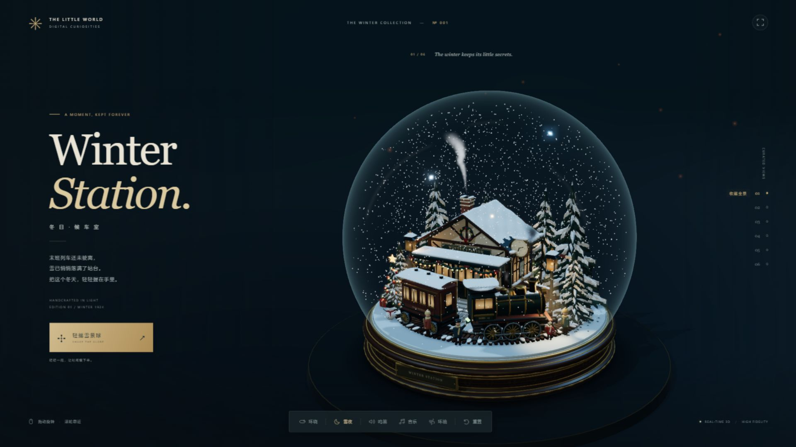
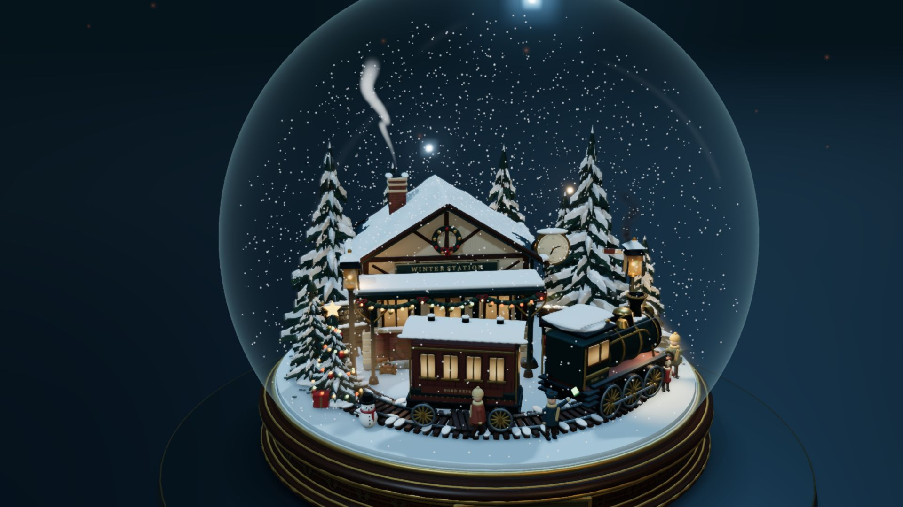
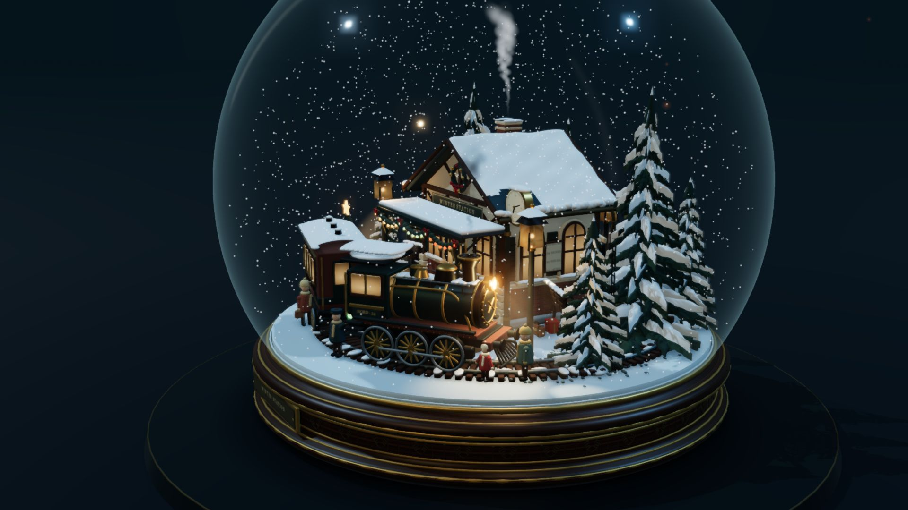
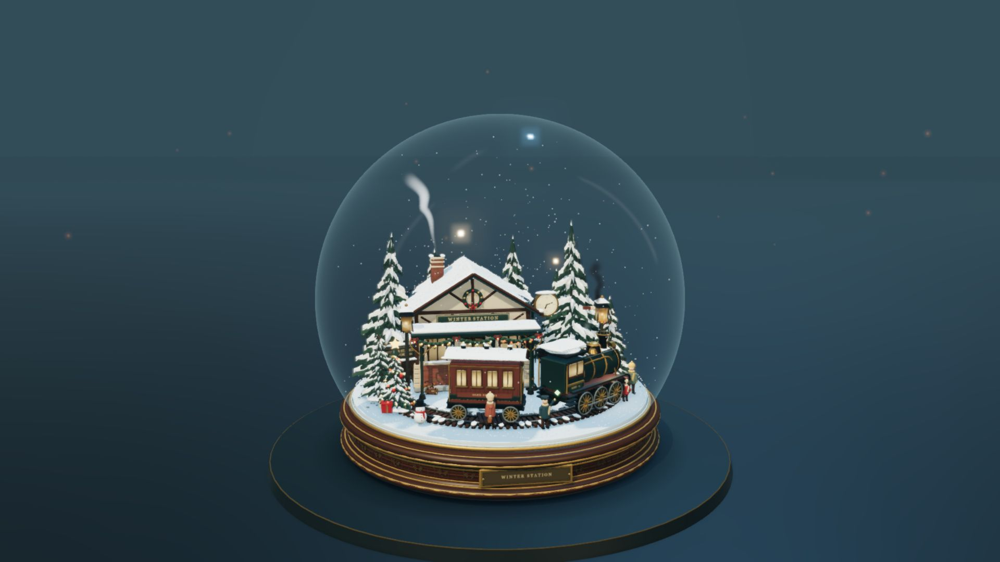
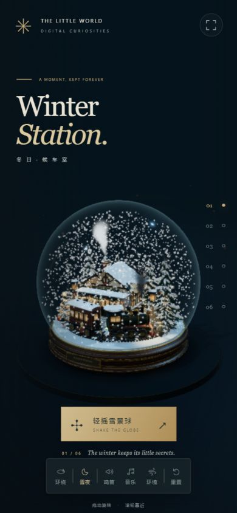

# Winter Station · 冬日复古车站雪景球

> 一个基于 **Three.js** 开发的原创 3D 数字微缩景观收藏品与交互式雪景球（Snow Globe）。  
> **零外部 3D 模型依赖 · 纯代码程序化几何与纹理 · 物理碰撞雪花 · 原创合成音乐音效 · 离线单文件畅玩**



---

## 📖 项目简介

**「Winter Station」** 是一个封装在精致光学玻璃球中的 3D 维多利亚复古车站微缩数字藏品：

底座由**车削胡桃木**与**黄铜收边铭牌**打造，球内精巧坐落着一座白雪覆盖的红砖木构火车站。一列冒着腾腾蒸汽的复古机车停靠在月台旁，月台上站长正挥舞信号旗，长椅上的旅人在微弱暖黄的路灯下读书，树顶的圣诞彩灯缓缓明灭。

整个项目坚持**极客级全代码自主生成（Zero-Asset Dependency）**：
- **纯代码生成模型**：所有站房建筑、蒸汽机车、车轮连杆、铁轨道岔、分枝松树及六位微缩人物，均通过 Three.js 原生程序几何（Extrude、Lathe、Tube、Mesh）在代码中精确构建，**没有下载任何外部 GLB/OBJ 3D 模型**。
- **动态物理雪景交互**：球体内封装了 **2,600 片独立物理雪花**。按下「轻摇」或按空格键，雪花将在玻璃球内部翻腾、彼此碰撞并最终缓缓沉降至屋顶与地面。
- **冬昼 / 雪夜无缝过渡**：支持一键平滑切换明亮的冬日白昼与静谧的暖光雪夜，带有细腻的窗格光影投影与实时深度裁切体积光束。
- **电影级机位运镜**：内置 6 组精心校准的特写运镜，沿着玻璃球体外侧平滑插值移动。
- **原创合成音效与音乐**：内置三段原创音频（C 大调音乐盒小圆舞曲、站台冬风环境音、三管蒸汽鸣笛声），均由项目内置脚本通过代码算法物理合成。
- **单文件离线即开即用**：提供内置了完整 Three.js 引擎、着色器代码、程序纹理与 Base64 音频的 `Winter-Station-离线单文件.html`，无需联网、无需启动本地服务器，双击即可直接在浏览器畅玩！

---

## 🖼️ 场景图集展示

| 车站主体与月台灯光 | 蒸汽机车与连杆细节 | 摇晃雪景物理翻腾 |
| :---: | :---: | :---: |
|  |  |  |

| 冬日白昼模式 | 俯瞰屋顶积雪与冰柱 | 移动端触控体验 |
| :---: | :---: | :---: |
|  |  |  |

---

## 🚀 快速上手与运行方式

### 方式 1：双击离线单文件运行（最推荐，零依赖）
- 直接使用现代浏览器（Chrome、Edge、Safari、Firefox）双击根目录下的：  
  👉 **`Winter-Station-离线单文件.html`**
- 该文件内嵌了完整的 Three.js 引擎、渲染管线、程序纹理和全部三段 MP3 音频，无需安装 Node.js、无需联网、无需本地服务器，单文件可自由复制分享。

### 方式 2：本地 Node.js 服务器启动
1. 双击运行根目录下的 **`启动雪景球.cmd`**；
2. 或者在终端中执行：
   ```powershell
   node server.mjs
   ```
3. 浏览器会自动打开 `http://127.0.0.1:5176`，关闭命令行窗口即可停止服务。

### 方式 3：二次开发与打包
```powershell
# 安装依赖 (Three.js 与 esbuild)
npm install

# 编译生成本地 bundle 及单文件 HTML
npm run build

# 运行自动化自检测试 (验证雪花粒子边界、机位轨迹与离线包完整性)
npm test
```

---

## 🕹️ 把玩与操作指南

| 键盘按键 / 鼠标手势 | 界面按钮 | 功能说明 |
| :--- | :--- | :--- |
| **鼠标左键 / 单指拖动** | - | 围绕玻璃雪景球 360° 自由旋转观察 |
| **滚轮滑动 / 双指捏合** | - | 镜头推进或拉远（严格限制在玻璃球壳外部安全距离） |
| **空格键 (Space)** | ❄️ 轻摇 | **轻摇雪景球**：唤醒 2,600 片雪花剧烈翻腾、旋转并自然漫落 |
| **A 键** | 🔄 环绕 | 切换平滑自动环绕运镜（约 50 秒平稳匀速自转一圈） |
| **N 键** | 🌙 / ☀️ | **昼夜切换**：在温暖冬夜与明亮冬昼之间平滑过渡光照与天色 |
| **数字键 1 ~ 6** | 01 ~ 06 | **电影特写**：切换六组特写镜头（全景/车站/机车/侧舷/俯瞰/后场） |
| **W 键** | 🚂 鸣笛 | 触发蒸汽机车鸣笛，同时加强机车阀门白蒸汽喷发 |
| **M 键** | 🎵 音乐 | 播放/暂停原创 C 大调圣诞圆舞曲（音乐盒与尼龙弦交织） |
| **E 键** | ❄️ 环境 | 开启/关闭冬风呼啸、机车气阀与远处钟声的环境声场 |
| **R 键** | ↺ 重置 | 镜头复位至默认藏品全景构图 |
| **H 键 / Esc** | 👁️ 隐藏 | 隐藏或还原所有界面 UI，将雪景球置于画面正中央 |

---

## 🌲 场景精细建模与艺术细节

1. **底座与光学玻璃球**：
   - 底部采用胡桃木纹车削底座，点缀黄铜固定螺钉、雕花压边与金属铭牌；
   - 球体采用薄壁光学玻璃着色器，拥有环境反射、边缘菲涅耳高光（Fresnel）与微折射效果。
2. **复古砖木车站**：
   - 包含四面完整的红砖砌体、拱窗百叶、木桁架、门把手、排水管与屋檐悬挂的冰柱。
3. **高精细节蒸汽火车**：
   - 带有辐条的车轮、联动侧连杆、铜质导管、铆钉锅炉环、发光的驾驶室与客车窗格。
4. **月台生活与动态人物**：
   - 包含双面站台挂钟、路灯、时刻表、行李小车、石板积雪小径；
   - 场景内有 **6 位带有关节微动作的微缩人物**（挥旗站长、提箱赶车的乘客、长椅读书人、后场装卸工等）。
5. **受 GPU 风场吹拂的松树**：
   - 8 棵独立树木具有完整分枝与针叶扇面，GPU Vertex Shader 计算风动效果，树根稳定固定，树冠枝雪与投影同步自然摆动。
6. **实体照明与体积光束**：
   - 9 组真实投射光源，带有窗格投影视网膜贴图与雪地光斑；光束采用光线步进积分并由深度缓冲裁切，准确停留在积雪与模型表面。

---

## 🛠️ 技术栈与依赖

- **核心渲染库**：[Three.js](https://threejs.org/) (`0.170.0`)
- **构建打包工具**：[esbuild](https://esbuild.github.io/) (`0.25.12`)
- **纹理与贴图**：本地 Canvas 程序化生成器（固定随机种子，1024×1024 砖石、胡桃木与雪面贴图）
- **原创音频合成器**：`tools/make-audio.mjs`（基于代码算法合成波形，零采样盗用）
- **开源许可证**：MIT License（详见 [vendor/THREE-LICENSE.txt](vendor/THREE-LICENSE.txt)）
