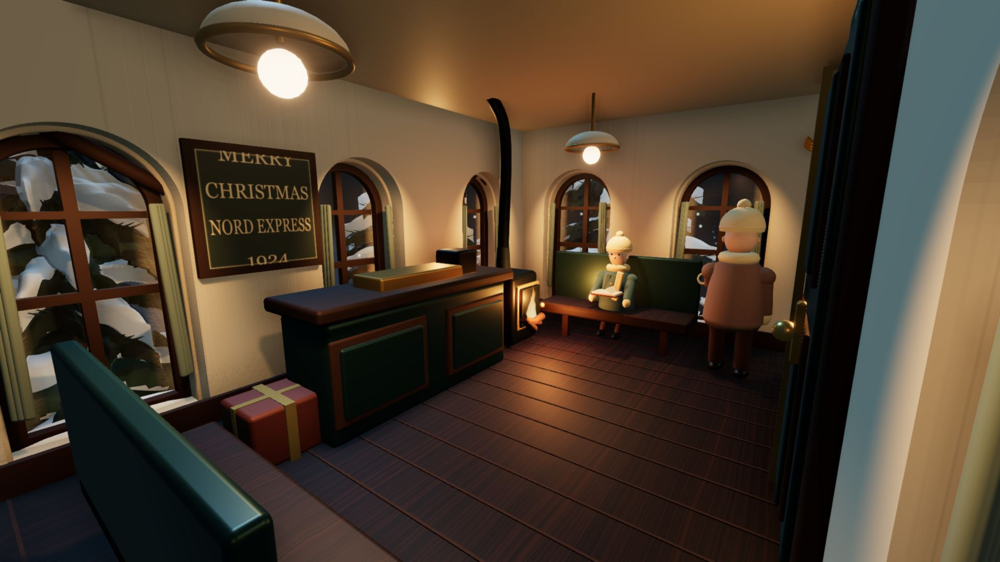
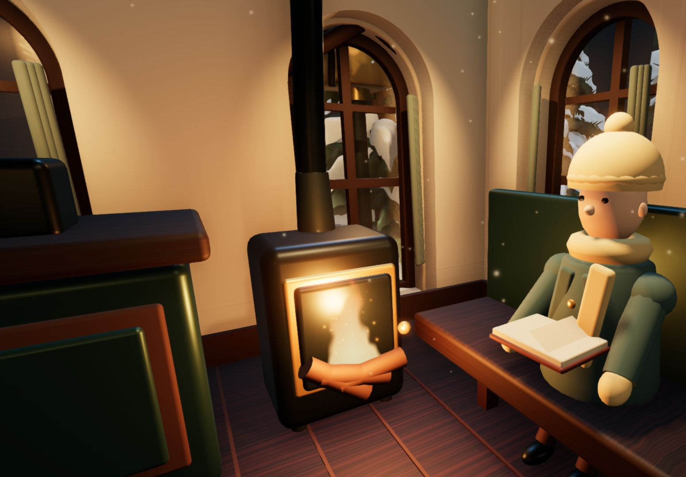
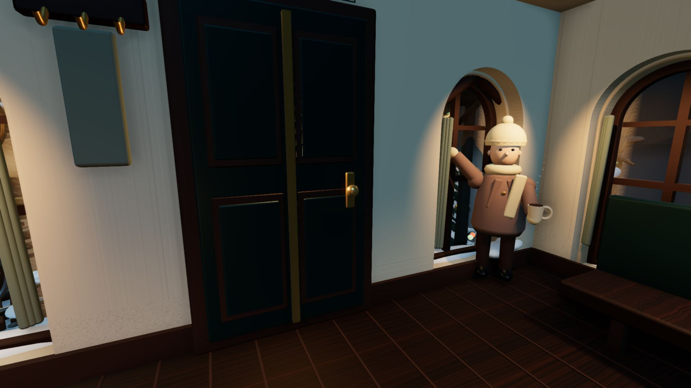
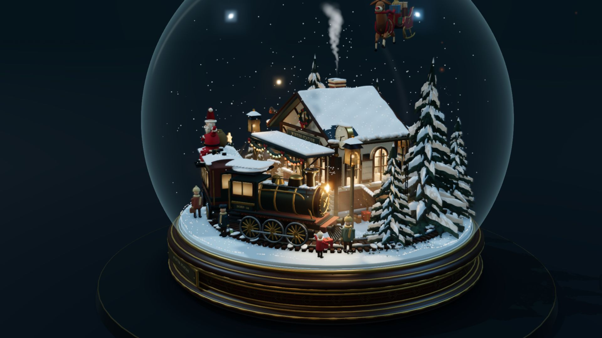
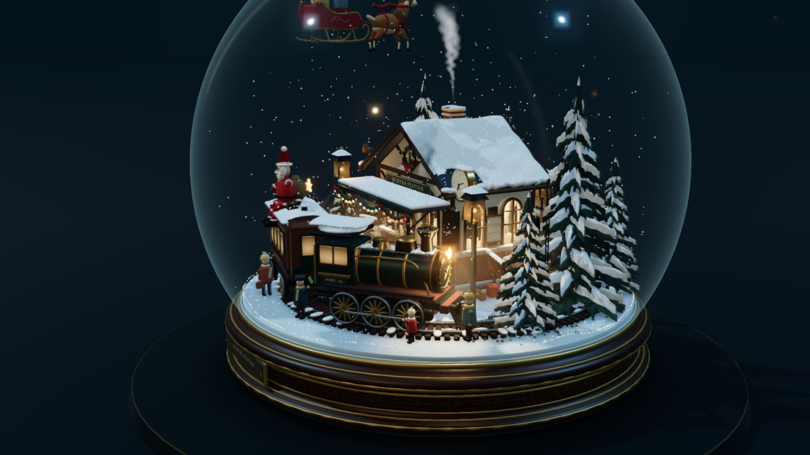
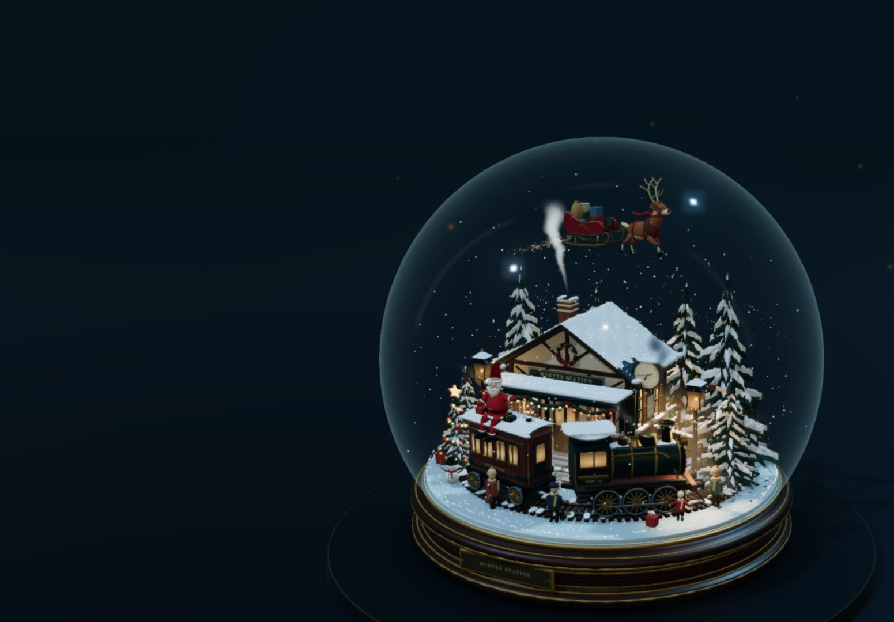

# Winter Station · 冬日复古车站雪景球

> 版本 **1.7.0** · 基于 **Three.js** 开发的原创 3D 数字微缩景观收藏品与交互式雪景球（Snow Globe）。  
> **零外部 3D 模型依赖 · 纯代码程序化几何与纹理 · 物理碰撞雪花 · 72 秒微缩生活剧 · 候车室探访 · 离线单文件即开即玩**


---

## 📖 项目简介（这是干嘛的？）

**「Winter Station」** 是一个封装在精致光学玻璃球中的 3D 维多利亚复古车站微缩数字藏品：

底座由**车削胡桃木**与**黄铜收边铭牌**打造，球内精巧坐落着一座白雪覆盖的红砖木构火车站。一列冒着腾腾蒸汽的复古机车停靠在月台旁，月台上站长正挥舞信号旗，长椅上的旅人在微弱暖黄的路灯下读书，树顶的圣诞彩灯缓缓明灭。

整个项目坚持**极客级全代码自主生成（Zero-Asset Dependency）**：
- **纯代码生成模型**：所有站房建筑、蒸汽机车、车轮连杆、铁轨道岔、分枝松树及微缩人物，均通过 Three.js 原生程序几何（Extrude、Lathe、Tube、Mesh）在代码中精确构建，**没有下载任何外部 GLB/OBJ 3D 模型**。
- **动态物理雪景交互**：球体内封装了 **2,600 片独立物理雪花**。按下「轻摇」或按空格键，雪花将在玻璃球内部翻腾、彼此碰撞并最终缓缓沉降至屋顶与地面。
- **冬昼 / 雪夜无缝过渡**：支持一键平滑切换明亮的冬日白昼与静谧的暖光雪夜，带有细腻的窗格光影投影与实时深度裁切体积光束。
- **电影级机位运镜**：内置 6 组精心校准的特写运镜，沿着玻璃球体外侧平滑插值移动。
- **原创合成音效与音乐**：内置三段原创音频（C 大调音乐盒小圆舞曲、站台冬风环境音、三管蒸汽鸣笛声），均由项目内置脚本通过代码算法物理合成。
- **单文件离线即开即用**：提供内置了完整 Three.js 引擎、着色器代码、程序纹理与 Base64 音频的 `Winter-Station-离线单文件.html`，无需联网、无需启动本地服务器，双击即可直接在浏览器畅玩！

---

## 🖼️ 场景高清图集展示 (Gallery)

### ❄️ 经典藏品全景与冬日氛围

| 藏品夜景全景 | 蒸汽机车与月台灯光 | 冬日白昼模式 |
| :---: | :---: | :---: |
|  |  |  |

### 🛋️ 走进候车室与温暖室内视角

| 候车室全景一览 | 炉火微尘与读书人 | 窗边茶话与真实窗光 |
| :---: | :---: | :---: |
|  |  |  |

### 🎄 72 秒微缩生活剧与车站剧情

| 降落伞空投圣诞礼物 | 小朋友抱起礼物欢呼 | 蒸汽列车鸣笛出站 |
| :---: | :---: | :---: |
|  |  |  |

### ✨ 粒子氛围、雪花翻腾与移动端适配

| 雪橇星屑尾迹 | 2,600 片雪花轻摇翻腾 | 手机端竖屏自适应 |
| :---: | :---: | :---: |
|  |  |  |

---

## 🌟 最新版本更新了啥？ (v1.7.0 更新特性)

### 1. ✨ 新增粒子氛围系统 (`src/particle-effects.js`)
- **室内暖光微尘**：候车室内有 144 颗轻柔漂浮的悬浮微尘，铸铁火炉玻璃门内有 22 颗实时升腾的炉火余烬。
- **飞天雪橇星屑**：飞天麋鹿牵引礼物雪橇时，在空中拖曳出金色与冰蓝色的弧形闪烁星屑轨迹。
- **礼物着陆星芒**：空投的礼物在落地瞬间向四周绽放细碎的星光光环，两秒后平滑消散。
- **全物理遮挡**：所有粒子均为场景中的真实三维粒子，人物与建筑会产生精确的前后遮挡，并随雪景球的晃动同步产生惯性漂移。

### 2. 🛋️ 走进候车室（室内探访功能 `src/interior-camera.js`)
- 点击底部 **「进站」** 按钮或按键盘快捷键 **`I`**，相机将穿过玻璃与站房大门，无缝过渡至站房内部。
- 新增三大室内专属机位（支持快捷键 **`7 / 8 / 9`** 直达）：
  - **`7` 候车室全景**：纵览复古木质地板、双吊灯、售票窗口与长椅；
  - **`8` 窗边茶话**：近距离观察窗边端茶踱步、向窗外挥手问候的旅人；
  - **`9` 炉边阅读**：近景感受壁炉暖火、余烬飞舞与安静翻书的旅客。
- 室内支持 **360° 水平自由环视** 与滚轮景深缩放；随时按 **`Esc`** 或点击「返回雪景球」平滑回到球外视界。

### 3. 🚂 72 秒微缩车站生活剧 (`src/station-story.js`)
- **火车鸣笛发车**：站长举旗指挥，列车主汽笛鸣响，连杆联动推进，车头缓缓驶出站台一段距离后返回。
- **圣诞空投投递**：飞天麋鹿拉动雪橇掠过天空，空投出挂着红白条纹降落伞的圣诞包裹；站台上的小朋友欢快跑上前抱起礼物并向圣诞老人挥手。
- **车站生灵百态**：屋檐与站牌间有灵动的知更鸟展翅飞掠并发出清脆鸟鸣；月台长椅旁的小猫伸懒腰、打盹与散步。
- **点击交互互动**：鼠标点击场景内的圣诞老人、麋鹿、窗内旅客、知更鸟或列车，他们都会转头做出专属动作与声音回应！

---

## 🌲 场景精细建模与艺术细节

1. **底座与光学玻璃球**：
   - 底部采用胡桃木纹车削底座，点缀黄铜固定螺钉、雕花压边与金属铭牌；
   - 球体采用薄壁光学玻璃着色器，拥有环境反射、边缘菲涅耳高光（Fresnel）与微折射效果。
2. **复古砖木车站**：
   - 包含四面完整的红砖砌体、拱窗百叶、木桁架、门把手、排水管与屋檐悬挂的冰柱。
3. **高精细节蒸汽火车**：
   - 带有辐条的车轮、联动侧连杆、铜质导管、铆钉锅炉环、发光的驾驶室与客车窗格。
4. **月台生活与动态人物**：
   - 包含双面站台挂钟、路灯、时刻表、行李小车、石板积雪小径；
   - 场景内有 **6 位带有关节微动作的微缩人物**（挥旗站长、提箱赶车的乘客、长椅读书人、后场装卸工等），以及 2 位室内旅客。
5. **受 GPU 风场吹拂的松树**：
   - 8 棵独立树木具有完整分枝与针叶扇面，GPU Vertex Shader 计算风动效果，树根稳定固定，树冠枝雪与投影同步自然摆动。
6. **实体照明与体积光束**：
   - 13 组真实投射光源，带有窗格投影视网膜贴图与雪地光斑；光束采用光线步进积分并由深度缓冲裁切，准确停留在积雪与模型表面。

---

## 🚀 运行方式

### 方式 1：双击离线单文件运行（最推荐，零依赖）
- 打开根目录下的 **`Winter-Station-离线单文件.html`**。
- 引擎源码、着色器、程序化纹理与 3 段原创 MP3 音频全部内嵌为单文件，无需联网、无需本地环境，可在任意现代浏览器中完美离线运行！

### 方式 2：本地 Node.js 预览服务器
如果你安装了 Node.js 18+，可以直接双击根目录下的 **`启动雪景球.cmd`**，或在命令行中运行：
```powershell
node server.mjs --open
```
浏览器将自动打开 `http://127.0.0.1:5176`。

### 方式 3：二次开发与重新构建
```powershell
npm install
npm run build   # 重新构建 app.bundle.js 与离线单文件
npm test        # 运行全套自动化回归测试套件
```

---

## 🕹️ 把玩与操作指南

| 键盘操作 | 界面按钮 | 核心功能 |
| :--- | :--- | :--- |
| **鼠标左键 / 单指滑动** | - | 围绕雪景球 360° 自由旋转视角 |
| **滚轮滑动 / 双指捏合** | - | 镜头推进或拉远（严格限制在球体外安全距离） |
| **鼠标点击场景模型** | - | 发现角色、机车与小动物的交互回应 |
| **空格键 (Space)** | ❄️ 轻摇 | **轻摇雪景球**：唤醒 2,600 片雪花剧烈翻腾、旋转并自然沉降 |
| **A 键** | 🔄 环绕 | 切换平滑自动环绕运镜（约 50 秒平稳匀速自转一圈） |
| **N 键** | 🌙 / ☀️ | **昼夜切换**：在温暖冬夜与明亮冬昼之间平滑过渡 |
| **数字键 1 ~ 6** | 01 ~ 06 | **球外六组电影特写**（全景/车站/机车/侧舷/俯瞰/后场） |
| **I 键** | 🚪 进站 / 球外 | **进出候车室**：在雪景球全景与室内视角之间无缝切换 |
| **数字键 7 / 8 / 9** | 室内机位 | 直达室内三大机位（7 候车室 / 8 窗边茶话 / 9 炉边阅读） |
| **P 键** | ⏱️ 故事 | 暂停或继续 72 秒车站剧情循环 |
| **W 键** | 🚂 鸣笛 | 手动触发蒸汽机车鸣笛，伴随白汽泄压喷发 |
| **M 键** | 🎵 音乐 | 播放 / 暂停原创 C 大调圣诞音乐盒圆舞曲 |
| **E 键** | ❄️ 环境 | 开启 / 关闭冬风呼啸、蒸汽与事件音效 |
| **R 键** | ↺ 重置 | 镜头复位至默认藏品全景构图 |
| **H 键** | 👁️ 隐藏 | 隐藏或还原所有界面 UI，将雪景球置于画面正中央 |
| **Esc 键** | - | 恢复 UI；室内状态下按 Esc 快速返回球外全景 |

---

## 📁 仓库核心文件导航

| 文件 / 目录 | 内容说明 |
| :--- | :--- |
| **`Winter-Station-离线单文件.html`** | 完整内嵌运行版（开箱即玩，内置全部音频与着色器） |
| **`index.html` / `style.css`** | 网页入口与样式定义 |
| **`app.bundle.js`** | esbuild 预编译离线运行包 |
| **`src/interior-camera.js`** | 候车室三组室内机位与横竖屏构图管理 |
| **`src/particle-effects.js`** | 室内浮游微尘、炉膛余烬、雪橇星屑与礼物星芒 |
| **`src/station-story.js`** | 72 秒微缩剧情、降落伞投递与模型点击回应 |
| **`src/world-model.js` / `craft.js`** | 程序化建筑、道具几何与 Canvas 动态贴图 |
| **`src/train.js`** | 轨道计算、连杆轮辐物理联动与车体造型 |
| **`src/christmas-visitors.js`** | 圣诞老人、飞天麋鹿与礼物雪橇 |
| **`screenshots/`** | 27+ 张高清实机截图与浏览器自动化测试验证图库 |
| **`TEST-REPORT.md`** | 完整的自动化物理与画质测试报告 |
